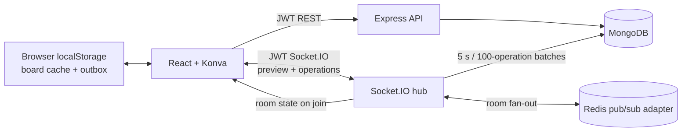

# BoardCollab

A real-time shared whiteboard built with React, Konva, Redux Toolkit, Express, Socket.IO, MongoDB, and an optional Redis Socket.IO adapter.

## Run locally

Requirements: Node.js 20+, npm, and Docker Desktop (or local MongoDB and Redis).

```powershell
Copy-Item .env.example .env
# Set JWT_SECRET to a random value of at least 32 characters.
docker compose up -d
npm install
npm run dev
```

Open `http://localhost:5173`. Create an account, create a board, and share its URL. To run without Redis, remove `REDIS_URL` from `.env`; the app uses Socket.IO's in-memory adapter for a single server.

## Deploy to Vercel and Render

This repository includes a Vercel project configuration at `vercel.json` and a Render Blueprint at `render.yaml`. MongoDB is a separately managed MongoDB Atlas database; no database credentials are committed.
The Render Blueprint defaults to its free plan so connecting it will not select a paid instance; free services may spin down while idle. For an always-on production service, change the Render plan after reviewing its current price.

1. Push this project to its own GitHub repository. Do not connect the unrelated parent repository containing this project directory.
2. In MongoDB Atlas, create a production database user and database, enable TLS, and allow connections from Render. Prefer Render's static outbound IPs with Atlas network access restricted to those addresses rather than `0.0.0.0/0`. Copy the Atlas connection string.
3. In Render, create a Blueprint from the project repository and select `render.yaml`. Set `MONGO_URI` to the Atlas connection string and `CLIENT_ORIGIN` initially to a temporary local value such as `http://localhost:5173`; Render generates `JWT_SECRET`. Deploy the `boardcollab-api` service and wait for its `/api/health` check to pass. The API URL will be `https://boardcollab-api.onrender.com`.
4. In Vercel, import the same repository with the project root set to the repository root (the directory containing `vercel.json`). Set the production environment variable `VITE_API_URL` to `https://boardcollab-api.onrender.com/api`, then deploy. Vercel builds only the frontend workspace.
5. Set Render's `CLIENT_ORIGIN` to the exact Vercel origin shown for the deployment (for example, `https://boardcollab.vercel.app`) and redeploy the API. Add any custom domain origins as comma-separated exact origins, without a trailing slash.
6. Test registration/login, create and share a public room, connect a second browser, and verify strokes synchronize and reload after a reconnect. Use a private room to verify invite-code access too.

Vercel's `VITE_API_URL` is injected at build time. If it changes, update the Vercel environment variable and redeploy the frontend. Keep Atlas credentials and any custom JWT secret in provider-managed environment settings; never put them in the repo or frontend variables. Render's default single instance uses the Socket.IO in-memory adapter. To scale the API horizontally, configure authenticated Redis via `REDIS_URL` and ensure the chosen hosting plan supports the required sticky WebSocket connections before increasing the instance count.

To test and build:

```powershell
npm test
npm run build
```

## Architecture



- MongoDB stores room metadata separately from per-element documents; it does not grow one large session document on every edit.
- Each durable element is a last-writer-wins register keyed by `(roomId, elementId)`. A Lamport clock orders edits, with actor ID as a deterministic tie-breaker. Deletes are tombstones, so late edits do not resurrect removed content.
- Drawing previews are volatile Socket.IO messages; committed operations are broadcast immediately and coalesced into MongoDB bulk writes (up to 100 operations or 5 seconds). MongoDB update pipelines compare versions atomically, including when multiple server instances persist edits.
- Redis distributes Socket.IO room messages across instances. Deployments behind a load balancer must enable WebSocket affinity/sticky sessions as required by the Socket.IO transport.
- Undo/redo is a bounded, browser-local history of the current user's operations. Undo is refused if another collaborator has since changed that element. Per-room versions are assigned by the server (and Redis when enabled), so untrusted client clocks cannot take over the conflict ordering.
- The browser caches board state and its pending operation outbox in localStorage. Offline edits queue through Socket.IO and replay after reconnect, subject to browser storage quota. Private board invite codes are random, stored hashed by the API, and included in the shared URL.
- The client memoizes element components and filters off-screen elements against the viewport. This baseline does not yet provide pan/zoom, indexed spatial virtualization, or a 10,000-element benchmark.

## Data and scaling notes

Element operations are stored as independent MongoDB documents with a unique `(roomId, elementId)` index; room metadata remains small. This avoids MongoDB's 16 MB document limit for a single embedded-elements array. For a sharded deployment, shard the element collection on a room-keyed strategy (for example, hashed `roomId`) and keep the unique-index design compatible with the chosen shard key. Redis is optional locally and needed for cross-process Socket.IO broadcasts in a horizontally scaled deployment.

The assignment's 50+ users, sub-100 ms synchronization, 10k-element ceiling, and 70% coverage are targets, not measured claims. No production or multi-client benchmark has been run from this workspace. Benchmark with clients distributed across the intended regions and track p50/p95/p99 acknowledgement-to-render delay, MongoDB batch latency, event-loop lag, and memory under 10k elements before making an SLO claim. This implementation limits an individual element payload to 64 KiB, an operation batch to 100, and undo history to 100 actions.
With Redis enabled, unflushed operations are staged in Redis and recovered into a MongoDB batch when that room next joins. Without Redis, the in-memory batch can be lost if the API process crashes before flushing; normal disconnects are handled by Socket.IO reconnect and the browser outbox.

## API

- `POST /api/auth/register` and `POST /api/auth/login` return a seven-day JWT.
- `POST /api/rooms` creates a public or invite-only board.
- `GET /api/rooms/:id` returns room metadata and element state; send `X-Room-Invite` for private boards.
- Socket.IO requires the JWT as `auth.token`. Join with `join-room`, broadcast previews with `draw-preview`, and commit edits with `draw-operations`.
- `GET /api/health` is a process health endpoint.

PNG and SVG export are performed client-side from the current board. MongoDB stores element state and tombstones so a reconnect can restore the board.

## Security and operational boundaries

Use HTTPS/WSS in deployment, a strong secret manager-backed JWT secret, strict CORS origins, TLS/authentication for MongoDB and Redis, and rate limiting at the API and Socket.IO edge. The current baseline authenticates every room join and protects private rooms with invite codes, but does not include user revocation, account recovery, abuse moderation, or an external identity provider. Configure backups and retention for room data before production use.
